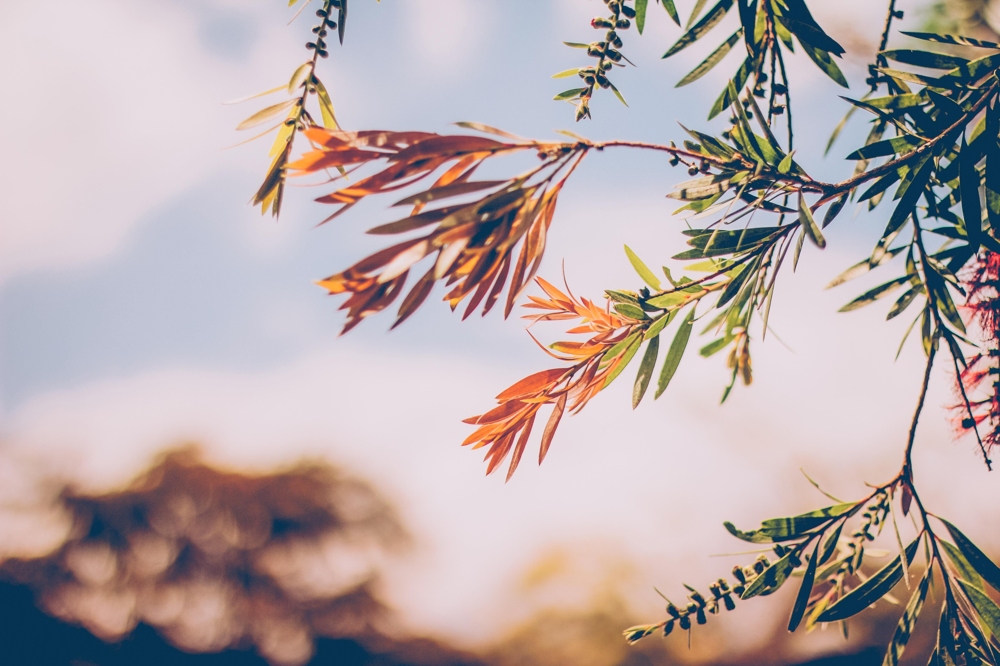
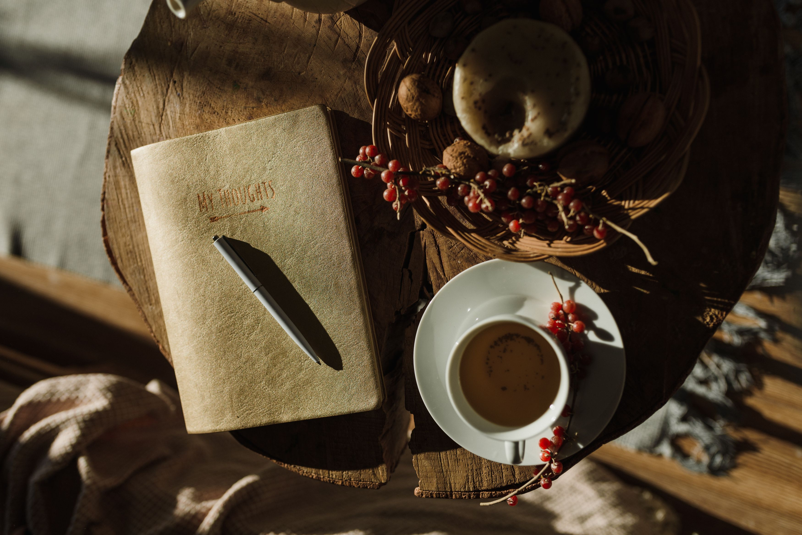

Quando le giornate iniziano ad accorciarsi, **la società ci spinge immediatamente a premere sull'acceleratore e comincia l’ansia da rientro.** Come ogni anno settembre viene venduto come il mese dei grandi propositi, dell'organizzazione maniacale di tutto e del **"dover ripartire" a tutti i costi** come se ci fosse una corsa ad ostacoli.

**Ma la Natura,** intorno a noi, **sta raccontando una storia completamente diversa.** E il caldo delle estati, sempre più intenso, ci sta ricordando che è proprio lei, Madre Natura, a decidere.

**Mabon** (nome celtico usato nella ruota dell’anno) per noi conosciuto come **l'Equinozio d'Autunno, ci ricordano che questo è il momento dell'equilibrio,** della soglia e del graduale ritorno verso l'oscurità. È il momento in cui le ore di luce e di buio si equivalgono, prima che la notte prenda il sopravvento sul giorno.

La maggior parte delle volte si parla di come gestire la stanchezza quando è ormai tardi, magari a novembre inoltrato.

In questo articolo voglio anticipare i tempi: **invece di tuffarci nella solita frenesia, possiamo avere una ripartenza di settembre senza ansia usando la saggezza di Mabon** e la biochimica del nostro corpo. Vivere un "Lutto Estivo" consapevole, e imparare a stoccare la "Luce Integrata" prima dell'inverno può essere una grande risorsa.

Come sempre fare un viaggio tra i miti antichi può aiutare i ritmi biologici e facilita l’integrazione di **piccole pratiche quotidiane per trasformare il post vacanza** o il post caldo, in un'opportunità di rigenerazione interiore.

## Mabon e l'Equinozio d'Autunno: il tempo della soglia e dell'equilibrio.

### La data e la simbologia dell'Equinozio.

Convenzionalmente celebrato il 22 settembre, **l'Equinozio d'Autunno varia in realtà tra il 22 e il 23 settembre,** nel momento esatto in cui il Sole si trova allo zenit dell'equatore. La parola latina *equinozio* significa letteralmente "tempo di giorni e notti uguali".

Per un breve, magico istante, ci troviamo con Mabon: **perfettamente in equilibrio tra la luce e l'oscurità nella ruota dell’anno.**

Grazie all’equinozio d’autunno e alla sua simbologia il potere del Sole cala e la Natura ci i**nvita a tornare verso il buio da cui tutti veniamo.**

### Il dio Mabon e i grandi Miti del Passaggio.

Il nome Mabon e il suo significato spirituale deriva dalla tradizione celtica e gallese (*Mabinogion*) e fa riferimento al "figlio della Madre", la Dea Modron (nella Gallia Romana Matrona). Ma ancora prima di Mabon, le civiltà antiche celebravano questo passaggio come la chiave per aprire le porte del mistero e dell'invisibile grazie proprio all’equinozio d’autunno.

Nella Grecia arcaica, durante l'equinozio si festeggiavano i Misteri Eleusini legati a Demetra, spesso raffigurata tra due portatori di fiaccole: una rivolta verso l'alto (l'equinozio di primavera) e una verso il basso (l'equinozio d'autunno). È qui che si colloca la discesa del mito di Persefone nell'Ade, un mito che riprende altri miti ancora più antichi e che ci ricorda che stiamo ritornando nella terra e verso il nostro interiore dopo mesi di vita in superficie.

Mabon ci insegna che scendere nella propria ombra non è una condanna, ma una scelta di maturità e trasformazione.

## Validare il "Lutto Estivo": fermarsi prima di ripartire

### Oltre l'ansia da prestazione di settembre.

Se guardiamo alla natura, **settembre non è il momento di piantare nuovi semi,** ma di fare parsimonia degli ultimi raccolti per prepararsi simbolicamente al riposo e **ritornare alla routine senza stress.**

**Ovvio che noi non andiamo in letargo!** Però pretendere di essere iper-produttivi subito e mentre le giornate si accorciano crea una frattura tra ciò che il nostro corpo sente e ciò che la mente richiede.

**La malinconia che caratterizza settembre,** che appare come un lutto estivo, **è la risposta naturale a una transizione.**

### Elaborare la fine dell'estate

**Invece di reprimere la malinconia,** proviamo a chiamarla con il suo nome: **un piccolo "Lutto Estivo".** L'estate è la stagione dell'estroversione, del calore, dell'espansione delle relazioni. **L'autunno ci chiede invece di iniziare lentamente a ritirarci,** quindi ben vengano **le uscite e gli aperitivi, ma insieme a un sano ascolto del corpo** che magari richiede già un po’ di riposo in più. Permetterci di provare nostalgia per la luce che se ne va, **senza far finta che sia estate fino ad ottobre,** significa rispettare la nostra ciclicità emotiva.

## La "Luce Integrata": come fare riserva dell'energia per l'inverno

**Mentre sul piano emotivo possiamo provare ad accogliere l'ombra,** sul piano **psicofisico possiamo agire con una certa strategia**, così da unire la simbologia solare alla biochimica. Nulla di nuovo insomma! Gli antichi lo facevano continuamente.

**Per questo ho preparato per te dei piccoli consigli per stancarsi meno e prepararsi all’inverno.**

Come possiamo **"stoccare" la luce dell'estate** dentro di noi **prima che arrivi il freddo di novembre?**

## Esercizi pratici e rituali semplici per l'Equinozio d’autunno

* **Esposizione al mattino:** Sfrutta la luce del sole di settembre appena ti svegli. Bastano pochi minuti all'aria aperta senza occhiali da sole per inviare uno stimolo al sistema nervoso, così aumenta la produzione di serotonina e si regola il ritmo sonno-veglia.
* **Prendi gli impegni che veramente senti di avere**. *Less is more!* Di quale tipo di riposo ho realmente bisogno in questo periodo?
* **Igiene digitale giornaliera e serale:** Disiscriviti da almeno una newsletter che non leggi più e chiudi le decine di schede aperte nel browser. Quando il sole tramonta, riduci l'esposizione alle luci blu dei dispositivi. La ghiandola pineale in questo modo produce melatonina seguendo il naturale calare della notte.

**Forse non torneremo a vivere esattamente al ritmo delle stagioni come gli antichi**, ma concederci il tempo di **rallentare a settembre è il regalo più grande** che possiamo farci per ripartire davvero cariche.

Se ami questi temi, nella mia newsletter condivido riflessioni, ritualità e contenuti dedicati alla Ruota dell'Anno e al vivere in sintonia con i ritmi della natura.

[\[Clicca qui per iscriverti]](https://martazola.it/newsletter/)

Testo e contenuti 2026 @martazola. Tutti i diritti riservati.
