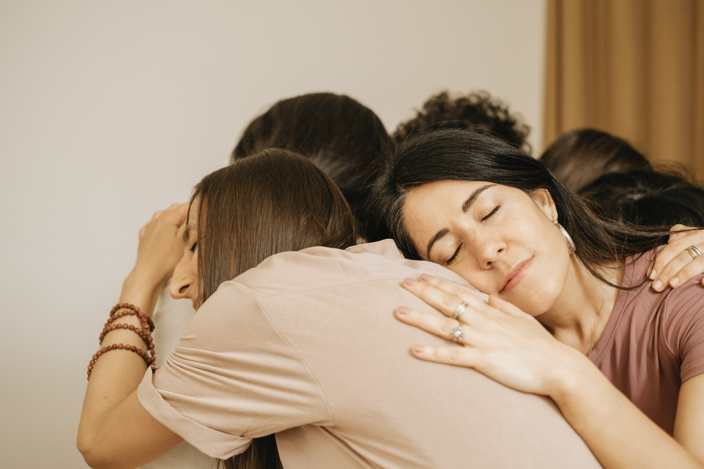

Settembre è il mese dei nuovi inizi. **Ottobre ci schiaffa in faccia i nostri limiti** e quanto sia difficile correre in un periodo, in cui il corpo farebbe il contrario.

**Non viviamo sulla luna,** quindi negare l’evidenza dei fatti fa parte di una spiritualità che non mi appartiene, **per questo voglio offrirti uno spazio di condivisione autentico,** anche se introspettivo. 

Uno spazio dove **io in prima persona sono in cammino** e cerco risposte, come te!

Ti è mai capitato di arrivare alla sera sederti sul divano e, i**nvece di goderti un momento di tranquillità, iniziare a pensare a tutto** quello che avresti ancora da fare?

Arrivano i pensieri del lavoro, l'amica che sta male, la casa e magari anche hai anche figli, ah e poi la coppia! 

**La mente va poi a una lista di cose più pratiche** (la lavatrice da avviare, quel messaggio a cui non hai risposto, la spesa da organizzare), proprio mentre il tuo corpo stava cercando una pausa. 

**Così ti rialzi e magari fai qualcosa,** oppure stai, ma si insinua **un sottile senso di colpa,** magari non sempre, ma sta lì. 

**E quando arriva il momento di riposo**, spesso sei troppo stanca per godertelo davvero e finisce che **non riesci a rilassarti anche quando hai tempo libero.** 

> Se ti riconosci in questa situazione, **forse non hai soltanto bisogno di riposare di più,** ma potresti aver bisogno di esplorare **il tuo rapporto con il riposo, con il dovere** e con quanto questo faccia parte della tua identità.  

Perché a volte **la parte più difficile è concedersi il permesso di fermarsi!**

## **Quando essere quella forte diventa parte della tua identità.** 

**Ci sono donne,** molte, che imparano da presto a essere **quelle su cui tutti possono contare o che tengono le redini di tutto.**

Sono quelle che ricordano, organizzano e trovano soluzioni. Quelle che, anche quando sono stanche, riescono a fare ancora qualcosa. Quelle che si lamentano di tutto e poi lo fanno o che cercano di non pesare sugli altri e stanno zitte. 

> Quando diventiamo *quelle forti*, possiamo fare fatica a riconoscere il diritto di essere anche stanche, vulnerabili, dubbiose o semplicemente senza voglia di fare.

E questo ha a che fare con un **inconscio collettivo familiare e prima ancora della società alla quale apparteniamo da millenni.** 

* A quale modello stiamo rispondendo convinte di essere moderne e femministe solo perchè lavoriamo?
* Insomma, come imparare a riposare senza sentirsi improduttive?

**Potremmo persino sentirci a disagio quando qualcuno si prende cura di noi,** perché siamo molto più abituate a dare che a ricevere.

E così, per anni, **confondiamo il nostro valore con quello che riusciamo a fare** per gli altri, per l’organizzazione che abbiamo, per il numero di *flag* fatti. 

> **Ma tu sei ancora tu!  E** **Il tuo valore non aumenta quando riesci a fare tutto e non diminuisce quando hai bisogno di fermarti.**

## 
**Perché non riesci a rilassarti anche quando hai tempo libero?**

A prima vista sembra una contraddizione: **siamo stanche, desideriamo fermarci e poi se lo facciamo ci sentiamo in colpa.** Potrei contare all'infinito le volte che è accaduto. 

Non esiste una sola ragione, perché può dipendere: dalle nostre esperienze, le aspettative familiari, l'ambiente di lavoro e da come intendiamo le responsabilità. 

### Prova a riconoscere se ti ritrovi in una di queste situazioni:

### 
**1. Hai imparato che prima vengono i doveri**

**Prima si lavora, poi ci si riposa.** Prima si sistema tutto, poi si fa il resto, perchè il riposo è un premio.

### **2. Ti senti responsabile anche di ciò che provano gli altri**

A volte la fatica sta anche da tutto quello che sentiamo di dover tenere sotto controllo.

Ti preoccupi che qualcuno possa rimanere deluso se dici di no, ti chiedi se stai facendo la cosa corretta con la tua famiglia o se qualcuno che conosci è in difficoltà.  

**Un autentico desiderio di cura non può sovrastare le responsabilità di ciascuno!**

### 
**3. Quando finalmente ti fermi, senti tutto quello che avevi messo da parte, in un angolino di te, quella più vera.** 

> **Questa è una possibilità di cui si parla meno, perché pesa, ma anche perché è la porta per la libertà.** 

Durante le giornate piene, passiamo continuamente da un'attività all'altra. **Quando ci fermiamo,** però, **può emergere:** **una preoccupazione, una delusione, un lutto non vissuto, una sensazione di solitudine o semplicemente la stanchezza accumulata.** 

Per questo **fermarsi fuori dai contesti “approvati” può essere inizialmente scomodo.**

Non significa che tutte le difficoltà siano nascoste nel corpo o che ogni disagio abbia una causa emotiva e neanche che ci ammaliamo sempre in vacanza. Significa che il silenzio porta quello era rimasto in secondo piano, ma che per noi aveva più valore.

**Non sto parlando di fare meditazioni nude nel bosco o di assumere una posizione yogica mentre canti un mantra,** che sono veramente magici se usati bene, ma che si svuotano di senso in questo nostro Occidente New Age. 

### 
**Parti da te:**

* Dal silenzio in una stanza
* Da un bagno caldo e della musica. 
* Dall’osservare il tuo respiro sotto pressione
* Dal capire quando sei stanca o sopraffatta. 

Torna a te senza cellulare e senti come stai veramente. 

> E quando arriva quella vocina: **“*Non ho fatto abbastanza”*, prova a chiederti: “*Abbastanza rispetto a che cosa?”***

Ovviamente, **non possiamo auspicare a una vita lineare,** non sarebbe umano, **ma possiamo attraversare le onde della vita in maniera diversa.** 

**Ti abbraccio**

\* Se ami questi temi, nella mia newsletter condivido riflessioni, consigli naturopatici e contenuti dedicati alla Ruota dell'Anno e al vivere in sintonia con i ritmi della natura.

[\[Clicca qui per iscriverti]](https://martazola.it/newsletter/)

Testo e contenuti © 2026 @martazola. Tutti i diritti riservati.
